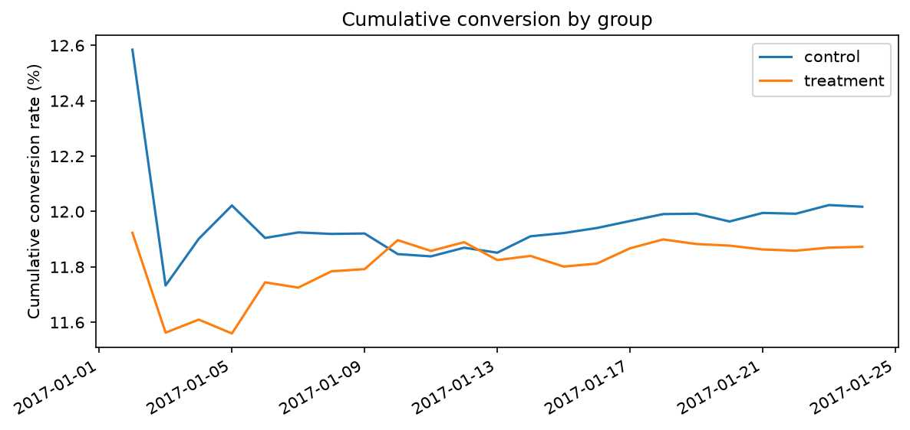
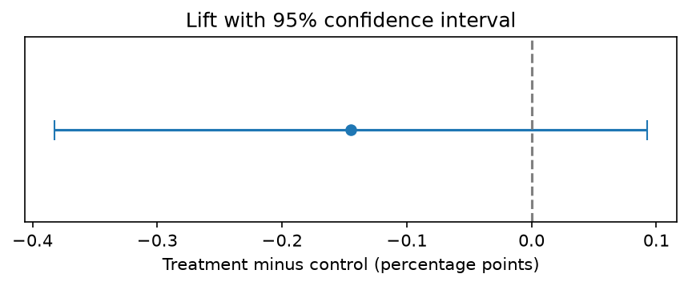

# Landing Page A/B Test: SQL + Python Experiment Analysis

**Result:** Recommend keeping the old page. Across 286,691 users, the new page converted 0.14 percentage points *lower* (11.87% vs. 12.02%; 95% CI: −0.38 to +0.09 points, p = 0.23), a difference that is not statistically significant. Even the best case in the confidence interval falls far short of the lift needed to justify a launch.



## Question

An e-commerce company tested a redesigned landing page against its existing page. Does the new page convert visitors into customers at a higher rate, and is the difference large enough to justify launching it?

## Hypothesis and Decision Rule

- **H0:** The new page's conversion rate equals the old page's.
- **H1:** The new page's conversion rate differs from the old page's.
- **Significance level:** α = 0.05, two-sided
- **Decision threshold:** a lift of at least 0.5 percentage points, the smallest gain worth the cost of launching a redesign.
- **Decision rule:** Ship the new page only if it is significantly better **and** the lift is at least 0.5 percentage points. Otherwise, keep the old page.

## Data

- **Source:** [Kaggle "A/B testing" dataset by Luyuan Zhang](PASTE_EXACT_KAGGLE_URL)
- **Size:** 294,478 rows from 290,584 unique users, covering January 2 to January 24, 2017 (about 3 weeks)
- **Columns:** `user_id`, `timestamp`, `group` (control/treatment), `landing_page` (old_page/new_page), `converted` (0/1)

The raw data is not committed to this repo. Download it from the link above and place `ab_data.csv` in `data/`.

## Data Cleaning (PostgreSQL)

The raw data had two integrity problems that would bias the result if left in:

1. **Mismatched exposure:** some users were assigned to one group but shown the other group's page.
2. **Duplicate users:** some users appear more than once.

Every user with a mismatched or cross-group record was removed entirely, since their outcome can't be attributed to either page. For the remaining users, a `ROW_NUMBER()` window function kept only their first exposure. The full logic is in [`sql/03_clean.sql`](sql/03_clean.sql).

| Step | Count |
| --- | --- |
| Raw rows | 294,478 |
| Unique users | 290,584 |
| Users removed (mismatched or in both groups) | 3,893 (1.3%) |
| Clean users analyzed | 286,691 |

## Validity Checks

- **Sample ratio:** control had 143,293 users (49.98%) and treatment had 143,398 users (50.02%). A chi-square test gave p = 0.84, so there is no evidence the 50/50 split broke.
- **Daily balance:** both groups received similar traffic on every day of the test ([`sql/04_checks.sql`](sql/04_checks.sql)).

## Results

| Group | Users | Conversions | Conversion rate |
| --- | --- | --- | --- |
| Control (old page) | 143,293 | 17,220 | 12.02% |
| Treatment (new page) | 143,398 | 17,025 | 11.87% |

- **Difference:** −0.14 percentage points (treatment minus control)
- **Two-proportion z-test:** z = −1.20, p = 0.23
- **95% confidence interval for the difference:** −0.38 to +0.09 percentage points
- **Minimum detectable effect:** with this sample size, the test had 80% power to detect a lift of 0.34 percentage points.



The confidence interval includes zero, so the data doesn't show a difference between the pages. The test was well powered: it could reliably detect a lift as small as 0.34 points, below the 0.5-point decision threshold. So this is evidence of no meaningful improvement, not a test too small to tell.

CHART_SENTENCE: describe what your cumulative conversion chart shows, e.g. "The cumulative conversion chart shows both groups' rates stabilizing within the first week and staying close for the rest of the test, so the result isn't driven by a short-term novelty effect."

## Recommendation

**Keep the old page.** The new page met neither condition of the decision rule: the difference was not significant, and the point estimate was negative. The upper end of the confidence interval (+0.09 points) is well below the 0.5-point threshold, so launching would add redesign and rollout costs with no realistic prospect of a meaningful conversion gain.

## Limitations

- The test ran for about 3 weeks, so long-term behavior such as repeat purchases isn't captured.
- Conversion is the only metric. Revenue per visitor, bounce rate, and time on page weren't available.
- The 3,893 removed users (1.3%) could differ systematically from those kept, though the share is small.

## How to Run

Requirements: PostgreSQL 14+ and Python 3.10+.

```bash
# 1. Clone and set up Python
git clone https://github.com/ryanpark123/ab-test-landing-page.git
cd ab-test-landing-page
python3 -m venv .venv
source .venv/bin/activate
pip install -r requirements.txt

# 2. Add your database password
echo "PG_PASSWORD=your_password" > .env

# 3. Download the dataset into data/, then build the database
psql -U postgres -d postgres -f sql/01_load.sql
psql -U postgres -d ab_test -f sql/02_explore.sql
psql -U postgres -d ab_test -f sql/03_clean.sql
psql -U postgres -d ab_test -f sql/04_checks.sql
psql -U postgres -d ab_test -f sql/05_metrics.sql

# 4. Run the analysis
jupyter notebook notebooks/analysis.ipynb
```

## Repo Structure

```
ab-test-landing-page/
├── sql/
│   ├── 01_load.sql        # create database and tables, import CSVs
│   ├── 02_explore.sql     # data-quality checks
│   ├── 03_clean.sql       # clean view with CTEs and ROW_NUMBER()
│   ├── 04_checks.sql      # sample ratio and daily balance
│   └── 05_metrics.sql     # conversion metrics with window functions
├── notebooks/
│   └── analysis.ipynb     # statistical tests and charts
├── charts/                # exported figures
├── requirements.txt
└── README.md
```

## Tools

PostgreSQL (CTEs, window functions, views) · Python (Pandas, SQLAlchemy, SciPy, Statsmodels, Matplotlib) · Jupyter
